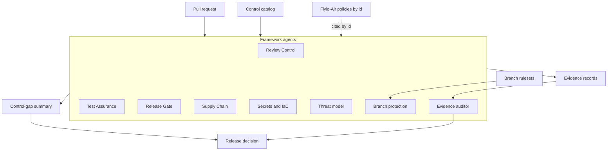

# Trust layer

Machine-readable SDLC controls for reviewing pull requests in this repository. Flylo-Air owns the policies and standards. Those documents live outside this repo and are cited here by id (`POL-SDLC-001`, `STD-SDLC-001`, and the other ids in `controls/catalog.yaml`). This directory does not contain policy, standard, or procedure text, and it is not the source of truth for them.

## What is in the repo

| Path                                          | Role                                                                                      |
| --------------------------------------------- | ----------------------------------------------------------------------------------------- |
| `controls/catalog.yaml`                       | Control id, stage, Flylo-Air policy id, framework mappings, check, evidence, owning agent |
| `branch-protection/`                          | Desired GitHub rulesets and an inactive CODEOWNERS fragment                               |
| `evidence/schema.json`                        | Schema for one evidence record                                                            |
| `evidence/validate.py`                        | Validator used by tests and CI                                                            |
| `evidence/examples/`                          | One valid record                                                                          |
| `.cursor/skills/trust-layer-*`                | Framework agents that review a pull request, plus the orchestrator `trust-layer-pr-qa`    |
| `.github/workflows/trust-layer-pr-review.yml` | Validates records and posts a summary                                                     |

## How agents use it

1. The agent loads only the catalog rows whose `owning_agent` is its id.
2. It reads the pull request diff, head SHA, reviews, and check runs named by those rows.
3. It compares what it found with `applicability`, `automated_check`, and `required_evidence`.
4. It writes one JSON record per judged control under `evidence/records/`. A pass without an artifact is invalid.
5. It publishes a control-gap report that names the control id, the Flylo-Air policy id, the finding, the severity, an evidence link, and a remediation.
6. The evidence auditor checks the schema, the head SHA, attestations, waivers, and that every in-scope control has a result.
7. The GitHub workflow re-validates the JSON and uploads the evidence summary. That summary does not replace the eight agent reports.

A missing record is a gap. A ruleset file, a Bugbot comment, or a green lint job is not a pass unless the catalog's check says it is.

## Pull request path



The release decision is the set of reports for that head SHA. Flylo-Air policy ids on the records say which external document the control implements. They do not pull the document into git.

## Agents

| Agent             | Policy       | Controls                 |
| ----------------- | ------------ | ------------------------ |
| Review Control    | POL-SDLC-002 | TL-REV-001 to TL-REV-005 |
| Test Assurance    | POL-SDLC-003 | TL-TST-001 to TL-TST-006 |
| Release Gate      | POL-SDLC-004 | TL-REL-001 to TL-REL-006 |
| Supply Chain      | POL-SDLC-005 | TL-SC-001 to TL-SC-006   |
| Secrets and IaC   | POL-SDLC-006 | TL-SEC-001 to TL-SEC-005 |
| Branch protection | POL-SDLC-007 | TL-BR-001 to TL-BR-007   |
| Threat model      | POL-SDLC-008 | TL-DES-001 to TL-DES-003 |
| Evidence auditor  | POL-SDLC-009 | TL-EVD-001 to TL-EVD-006 |

TL-EVD-002 also cites POL-SDLC-001, the Flylo-Air secure SDLC policy.

## Checks

```bash
python3 -m unittest discover -s trust-layer/evidence -p 'test_*.py' -v
python3 trust-layer/evidence/validate.py \
  --records-dir trust-layer/evidence/records \
  trust-layer/evidence/examples/pr-evidence.example.json
```

The ruleset JSON is not applied by CI. Applying it is a GitHub settings change and is out of scope for a pull request review.
